  

  

<h3 align="center">Peeps who dropped by</h3>

  

## 🛠️ Tech stack

  
  
  
  
  
  

  <picture>
    <source media="(prefers-color-scheme: dark)" srcset="https://raw.githubusercontent.com/FavnyWasTaken/FavnyWasTaken/output/github-contribution-grid-snake-dark.svg">
    <source media="(prefers-color-scheme: light)" srcset="https://raw.githubusercontent.com/FavnyWasTaken/FavnyWasTaken/output/github-contribution-grid-snake.svg">
    
  </picture>

